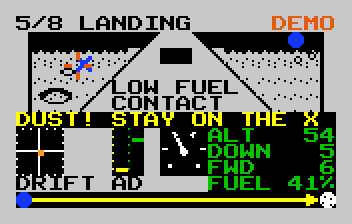

# Apollo

An original game for the Intellivision. Fly to the Moon and back from the
cockpit, in eight stages: liftoff, leaving Earth orbit, docking with the Lunar Module,
braking at the Moon, landing, lifting off to meet the Command Module, heading home,
and re-entry. Every prompt is in plain English.

**Play it in your browser:** https://plicerin.github.io/apollo/

## How to play

- **Disc** (arrow keys): keep the green `<>` on the crosshair.
- **Top side button** (Space or Enter): press when the bar under the window says so.
- **Lower side button** (B): brake while docking.
- **Keypad** (M, or 0 to 9): pause and show the trip map. On the title screen, 1 to 8 pick a stage.

## What's here

- `cockpit/cockpit.bas` is the game, in [IntyBASIC](https://nanochess.org/intybasic.html).
  `cockpit/gen_gfx.py` draws the graphics and writes `gfx.bas` and `gfx_const.bas`.
- `cockpit/cockpit.rom` is the cartridge image. It uses the 42K memory map, with
  the ECS optional (a second sound chip) and the Intellivoice optional (spoken callouts).
- `index.html` is the page, a single file with the cartridge inside it.
  `site/build.py` makes it from `site/template.html`, `site/inty.js`, `site/app.js` and `site/img/`.

## Building the cartridge

You need IntyBASIC and as1600 (from jzIntv). Copy IntyBASIC's `constants.bas` into `cockpit/`, then:

    intybasic --title "Apollo" cockpit.bas cockpit.asm <intybasic folder>
    as1600 -o cockpit.rom -l cockpit.lst cockpit.asm

To play it in jzIntv, with the extra PC keys:

    jzintv -s1 -v1 -z1 --kbdhackfile=apollo.kbd cockpit.rom

Add `-E <ECS ROM>` for the ECS. It has run in jzIntv and on the page's own
emulator, and hasn't been tried on real hardware yet.

## The browser version

`site/inty.js` is a small Intellivision written for this game: CP-1610 CPU, STIC
picture chip and the memory map. `site/app.js` adds the AY-3-8914 sound chips,
keyboard, gamepad and touch. It uses no Mattel code. The CPU starts straight at
the cartridge's program, and the letters are a stand-in character set. There's no
Intellivoice, so the spoken callouts are only heard in jzIntv.

Not affiliated with NASA or Mattel. Intellivision is a trademark of its owner.
